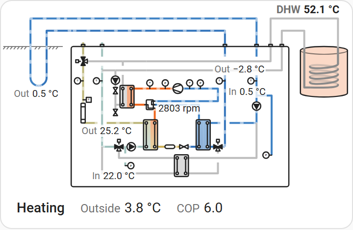

# ecoGEO heat pump card

A Lovelace card for Ecoforest ecoGEO heat pumps: the unit's internal schematic, drawn by the card as inline SVG,
with live values beside each component and the active circuits coloured by temperature. The card is read-only: it
shows the state of the unit and opens the more-info dialog of an entity, nothing else.

The card is meant to be used with the ESPHome firmware `esphome-ecoforest-ecogeo`, whose entity names are the
defaults. Every entity role can be overridden in the card configuration. See [docs/ecogeo-card.md](docs/ecogeo-card.md)
for the explanation of what the card shows and where each part comes from.


## Features

- The unit's internal schematic drawn as inline SVG after the manual's figures B1 to B4 and C, with the item number of
  every component shown only with `detail: full` (components show their name on hover), for any model, variant,
  outer-loop source (air, ground or hybrid) and DHW storage.
- Pipes coloured by temperature on an absolute scale (blue at -10 °C, light blue at 10 °C, pale blue at 20 °C, amber at
  30 °C, orange at 50 °C, red at 70 °C; `colors` changes the stops). Each pipe takes the probe that defines it; a pipe
  with no probe value is muted. The plate exchangers are filled on each side with a gradient from the colour of the pipe
  that enters it to the colour of the pipe that leaves it (`exchanger_fill: none` turns that off).
- The active circuits move: dashes run in the direction of the flow at a speed that follows the pump or the
  compressor, the refrigerant reverses in active cooling, and the circuits that are idle in the derived operating mode
  are muted. `prefers-reduced-motion` stops all animation.
- Live values beside their components (temperatures, pressures, pump and compressor speeds, power, the tank's values;
  the superheat and the expansion valve's opening at `detail: full`) and a footer with the mode, season, outside
  temperature, COP (EER while cooling) and the power items of the mode (DG1 and HTR while heating, DHW while producing
  DHW, Cooling and HTR in active cooling). The card formats the numbers itself with Home Assistant's locale and keeps
  every number joined to its unit by a no-break space.
- A visual editor (add the card from the picker, or edit it) for the unit, the entity prefix, the features and the
  appearance; it writes only what you set and keeps every other key.
- Read-only: tapping a value, or a component with an entity of its own, opens the entity's more-info dialog; the card
  calls no service and writes no entity.

## Status

Released and in use. The card validates its configuration, resolves its entities (or shows built-in sample values),
reads them, derives the operating mode and draws the schematic with coloured, flowing pipes and live values. The visual
editor is built (see Visual editor below). Planned follow-up changes: `add-hacs-release` and `add-browser-tests`. Extra
circuits (DG2, DG3, the pool) are a long-term idea only: they are external to the unit and need their own valves, so the
card does not draw them.

## Installation

Copy `dist/ecogeo-card.js` to the Home Assistant `www` folder, register it as a `module` dashboard resource and add
the card to a view. The steps are in the Installation section of [docs/ecogeo-card.md](docs/ecogeo-card.md).

The card measures its own width and chooses a layout from it (the `layout` option, see Options). With `layout: auto`
(the default) it shows the full layout from 600 px wide (from 640 px wide with `detail: full`), which is a panel view or
a wide section, and the compact layout below that, which is what a phone gets. The compact layout shows the schematic at
the simplified detail level, whatever `detail` says, without the captions inside the drawing and with only the key
labels (production out and in, brine out and in, compressor speed, the DHW temperature and the source's outlet
temperature), at least 10 px high and, for production and brine, captioned In and Out and the DHW temperature captioned
DHW, and a shorter footer (mode, COP or EER, outside temperature and the alarm and offline indications). Pipes and
outlines never render thinner than 2 px and 1.25 px, and the footer wraps. Once compact, the card returns to full only
at 624 px, or 664 px with `detail: full` (24 px of hysteresis), so a scrollbar appearing with the layout cannot make it
flip back and forth. Set `layout: full` or `layout: compact` to force one. In a panel view the card also fits the
screen: the drawing is kept within the window's height below Home Assistant's header (and above the footer), narrower
and centred when the card is wider than that, and the layout and line widths follow the drawing's own width. A tall
window or a sections view is not affected: the drawing fills the card. How the thresholds were measured, and what each
tier holds, is in [docs/ecogeo-card.md](docs/ecogeo-card.md).



## Configuration

```yaml
type: custom:ecogeo-card
model: B
variant: 4
source: air
dhw: external
prefix: demo_ecogeo
features:
  passive_cooling: unused
entities:
  dhw:
    temperature: sensor.boiler_top
```

A config with only `type: custom:ecogeo-card` shows the schematic with built-in sample values (a heating day) and a
muted "Sample values" note. As soon as `prefix` or any entity is set, only real states are used: a role without an
entity shows no value, never a sample value.

An invalid config makes the card show Home Assistant's error card; the message names the option, feature or role at
fault.

### Options

| Option | Values | Default | Description |
|---|---|---|---|
| `model` | `B`, `C` | `B` | The unit model: B has an external DHW tank, C an internal one. |
| `variant` | `1` to `4` | `4` | The manual's figure B1 to B4: which cooling parts the unit has (see Features). |
| `source` | `air`, `ground`, `hybrid` | `ground` | The outer loop joined to ports 3/4. |
| `dhw` | `external`, `internal`, `unused`, `none` | `external` on B, `internal` on C | The DHW storage. `unused` draws the model's tank muted, with no tank values, for a tank that is there but not in use; it is valid on both models. Model C always has its integrated tank, so `none` on model C is an error, as is `internal` on model B or `external` on model C. |
| `prefix` | lowercase letters, digits, `_` | none | Entity object id prefix; the firmware default is `ecoforest_ecogeo`. |
| `features` | group | from the variant | Feature states that override the variant (see Features). |
| `entities` | group | from the prefix | Entity id per role, nested by role path, or `none` for a role the unit does not have (see Roles). |
| `states` | group | `off: [OFF]`, `defrost: [Defrost]` | The state texts that mean off (the on/off entity) and defrost (the compressor mode entity); a list replaces its default, case-insensitive. See Using another source in the docs. |
| `colors` | list | built-in scale | Temperature colour stops, see Colours. |
| `exchanger_fill` | `gradient`, `none` | `gradient` | `gradient` fills each side of the plate exchangers 7, 8, 9 and 10 with a gradient from the colour of the pipe that enters it to the colour of the pipe that leaves it (muted when the circuit is idle); `none` leaves them unfilled. |
| `layout` | `auto`, `full`, `compact` | `auto` | `auto` shows the compact layout while the card is narrower than 600 px (640 px with `detail: full`) and the full layout otherwise (and before the width is known), with 24 px of hysteresis once compact (see Layout in the docs); `full` and `compact` use that layout at any width. |
| `detail` | `simplified`, `full` | `simplified` | `simplified` leaves out the service and safety parts with no live value, shows no item numbers and draws a wider, shorter cabinet with a smaller outer-loop source and external tank, so the labels get room, and leaves out the superheat and the expansion valve's opening (tap the valve for the opening); `full` draws every part of the manual figure with its item number, in the original, taller cabinet. |

### Source and DHW

`source` chooses what is drawn left of the cabinet on ports 3/4, and `dhw` the storage joined to ports 5/6 (or the
tank inside the cabinet on model C):

```yaml
# an air unit with a fan that rotates with its speed
type: custom:ecogeo-card
prefix: demo_ecogeo
source: air
dhw: external
```

```yaml
# a ground loop, and no DHW storage (model B only): no tank, no ports 5/6, no valve 26, no HTR
type: custom:ecogeo-card
prefix: demo_ecogeo
source: ground
dhw: none
```

```yaml
# model C with its integrated tank not in use: tank 50 drawn muted without values, HTR still drawn
type: custom:ecogeo-card
prefix: demo_ecogeo
model: C
dhw: unused
```

```yaml
# air unit and ground loop on one brine loop, with the integrated tank of model C
type: custom:ecogeo-card
prefix: demo_ecogeo
model: C
source: hybrid
dhw: internal
```

| `source` | Drawn |
|---|---|
| `air` | An air unit with a four-pass coil and a fan, its brine In and Out values at its two ports on the side facing the heat pump. |
| `ground` | A ground loop: a single U-shaped loop below a ground line, with its In and Out values at the line. |
| `hybrid` | Both, in series on one brine loop (the air unit shows only its In and the ground loop only its Out). |

The top of the air unit or of the ground line is level with the top of the heat pump.

| `dhw` | Drawn |
|---|---|
| `external` | A tank with a coil right of the cabinet, joined to ports 5/6 (model B). |
| `internal` | The integrated tank 50 with coil 51 inside the cabinet (model C). |
| `unused` | The model's tank (external on B, integrated on C) drawn muted, with no tank values and no DHW circuit active; HTR is drawn if its feature says so. |
| `none` | Nothing DHW related (model B only). |

### Features

Each key takes `true` (present and in use), `false` (not present, not drawn) or `unused` (present and drawn
muted; its own function is never derived). A key overrides the variant for that part only.

| Feature | Parts (manual items) | Variant 1 | Variant 2 | Variant 3 | Variant 4 |
|---|---|---|---|---|---|
| `active_cooling` | cycle inversion valve 14 | `false` | `false` | `true` | `true` |
| `passive_cooling` | exchanger 10, valves 27 and 28 | `false` | `true` | `false` | `true` |
| `htr` | exchanger 9, pump 17, valves 22 and 25 | `true` | `true` | `true` | `true` |
| `backup_heater` | outlet resistor 44 with thermostat 45 | `true` | `true` | `true` | `true` |

Exchanger 10 with valves 27 and 28 also serves defrost: it is active in a defrost whenever it is drawn (`true` or
`unused`).

### Roles

Every value the card reads is a role. With a `prefix`, a role defaults to `<domain>.<prefix>_<suffix>` (the
firmware entity naming); `entities` overrides single roles, nested by path: `entities: { dhw: { temperature:
sensor.boiler_top } }`. The card shows its own unit for every role (°F, kW and kPa, MPa, Pa, mbar and psi are
converted; a difference is shown in K). A number in a unit it cannot convert keeps the entity's unit, except
temperatures, differences and power, which then have no value.

A role the installation does not have (no pressure sensors) is set to `none`: `entities: { brine: { pressure: none } }`.
It gets no default entity, its label or footer item is not drawn (the component stays), and it counts as no value.
Hiding the efficiency in the footer takes both `unit.cop` and `unit.system_cop` set to `none`: with only `unit.cop` set
to `none`, the system COP shows once the firmware provides it. A role bound to an entity that is unknown or unavailable
keeps its label with a dash. `none` alone is still an entity setting, so the card does not show sample values.

| Role | Default entity | Shown as | Manual item |
|---|---|---|---|
| `production.outlet_temperature` | `sensor.<prefix>_production_out` | °C, 1 dec. | 33 |
| `production.return_temperature` | `sensor.<prefix>_production_in` | °C, 1 dec. | 34 |
| `production.pressure` | `sensor.<prefix>_pressure_production` | bar, 1 dec. | 38 |
| `production.pump` | `sensor.<prefix>_production_pump` | %, 1 dec. | 15 |
| `brine.outlet_temperature` | `sensor.<prefix>_brine_out` | °C, 1 dec. | 31 |
| `brine.inlet_temperature` | `sensor.<prefix>_brine_in` | °C, 1 dec. | 32 |
| `brine.pressure` | `sensor.<prefix>_pressure_brine` | bar, 1 dec. | 37 |
| `brine.pump` | `sensor.<prefix>_brine_pump` | %, 1 dec. | 16 |
| `compressor.speed` | `sensor.<prefix>_compressor_rpm` | rpm, 0 dec. | 11 |
| `compressor.percentage` | `sensor.<prefix>_compressor_percentage` | %, 1 dec. | 11 |
| `compressor.power` | `sensor.<prefix>_power_consumption` | W, 0 dec. | 11 |
| `compressor.suction_temperature` | `sensor.<prefix>_compressor_suction_temperature` | °C, 1 dec. | 29 |
| `compressor.discharge_temperature` | `sensor.<prefix>_compressor_discharge_temperature` | °C, 1 dec. | 30 |
| `compressor.suction_pressure` | `sensor.<prefix>_compressor_suction_pressure` | bar, 1 dec. | 35 |
| `compressor.discharge_pressure` | `sensor.<prefix>_compressor_discharge_pressure` | bar, 1 dec. | 36 |
| `compressor.mode` | `sensor.<prefix>_compressor_operation_mode` | text | 11 |
| `refrigerant.condensation_temperature` | `sensor.<prefix>_condensation_temperature` | °C, 1 dec. | 8 |
| `refrigerant.evaporation_temperature` | `sensor.<prefix>_evaporation_temperature` | °C, 1 dec. | 7 |
| `refrigerant.superheat` | `sensor.<prefix>_superheat` | K, 1 dec. | 12 |
| `refrigerant.expansion_valve` | `sensor.<prefix>_expansion_valve_position` | %, 0 dec. | 12 |
| `heating.capacity` | `sensor.<prefix>_condensation_capacity` | W, 0 dec. | 8 |
| `cooling.capacity` | `sensor.<prefix>_evaporation_capacity` | W, 0 dec. | 7 |
| `heating.demand` | `binary_sensor.<prefix>_dg1_demand` | on/off | 1/2 |
| `heating.setpoint` | `sensor.<prefix>_heating_dg1_setpoint` | °C, 1 dec. | 1/2 |
| `heating.power` | `sensor.<prefix>_heating_power_dg1` | W, 0 dec. | 1/2 |
| `dhw.temperature` | `sensor.<prefix>_dhw_temperature` | °C, 1 dec. | tank (54 on C) |
| `dhw.setpoint` | `number.<prefix>_dhw_setpoint` | °C, 0 dec. | tank |
| `dhw.start_delta` | `number.<prefix>_delta_t_start_dhw` | K, 0 dec. | tank |
| `dhw.demand` | `binary_sensor.<prefix>_dhw_demand` | on/off | 26 |
| `dhw.power` | `sensor.<prefix>_heating_power_dhw` | W, 0 dec. | 26 |
| `htr.active` | `binary_sensor.<prefix>_htr_active` | on/off | 9 |
| `htr.power` | `sensor.<prefix>_heating_power_htr` | W, 0 dec. | 9 |
| `source.fan_speed` | `sensor.<prefix>_aerothermal_fan_speed` | %, 1 dec. | air unit |
| `source.air_unit_outlet_temperature` | `sensor.<prefix>_brine_temperature_air_unit_outlet` | °C, 1 dec. | air unit |
| `source.outside_temperature` | `sensor.<prefix>_outside_temperature` | °C, 1 dec. | air unit / footer |
| `unit.on_off` | `sensor.<prefix>_heatpump_on_off` | text | footer |
| `unit.summer` | `binary_sensor.<prefix>_summer` | on/off | footer |
| `unit.winter` | `binary_sensor.<prefix>_winter` | on/off | footer |
| `unit.alarm` | `binary_sensor.<prefix>_alarm` | on/off | footer |
| `unit.connection` | `binary_sensor.<prefix>_status` | on/off | footer |
| `unit.cop` | `sensor.<prefix>_cop` | 1 dec., no unit | footer |
| `unit.system_cop` | `sensor.<prefix>_system_cop_display` | 1 dec., no unit | footer |

`heating.power`, `dhw.power`, `htr.active`, `htr.power` and `unit.system_cop` are optional: they have no entity when set
to `none`, or when they are not set in `entities` and their prefix defaults do not exist in Home Assistant (older
firmware, another integration; without a prefix there is no default). An entity id set in `entities` is kept, and shows
a dash while it is missing. A default entity that exists but is unavailable also shows a dash: the card does not fall
back because of a state.

A state that is `unavailable`, `unknown`, not a number or the firmware's -999.9 (an absent probe) is shown as no
value.

### Colours

`colors` is an ascending list of 2 to 8 stops, each a `temperature` in °C and a CSS `color`. Between two stops the
colour is mixed; below the first and above the last stop it is that stop's colour. A list that is too short or long, not
ascending, or with a value that is not a number or a CSS colour is a configuration error. Without the option the card
uses blue at -10 °C, light blue at 10 °C, pale blue at 20 °C, amber at 30 °C, orange at 50 °C and red at 70 °C (no
green). The plate exchangers take the colours of their pipes unless `exchanger_fill` is `none` (see the explanation
below).

```yaml
colors:
  - { temperature: 0, color: '#1565c0' }
  - { temperature: 35, color: '#f9a825' }
  - { temperature: 60, color: '#c62828' }
```

The colour scale, which pipe takes which probe and the animation are explained in
[docs/ecogeo-card.md](docs/ecogeo-card.md#colours).

### Visual editor

The card has a visual editor, so it can be added and set up from the dashboard without YAML: choose **Add card**, pick
**ecoGEO Schematic** (the preview shows the sample values, or the live values when exactly one device has the
firmware's entity names: the card then starts with that device's `prefix`), or open an existing card with **Edit**.
The editor is Home Assistant's own form and has six sections:

- **Unit:** model, variant (a select of the four variants), outer-loop source and DHW storage (the select offers only
  the storages the model allows: on B external, unused or none; on C internal or unused).
- **Entities:** a device picker and the entity prefix (`prefix`), and below the form a **Suggest entities** button.
  Pick the device that holds your heat pump (the picker works with any integration) and press the button: the card
  binds that device's entities to the roles that are empty or bound to an entity Home Assistant does not know, by
  domain, unit and name (English, Dutch, Spanish and German), and writes them as `entities`. A role bound to a known
  entity, or set to `none`, is not changed, and an entity serves one role at most. A list under the form says how
  many roles were filled and which stayed empty (no match, a weak match or a tie; fill them with the pickers); it
  stays until the next edit. The picked device is never written to the config, and the button is disabled without
  one. Pressing it turns **Advanced settings** on. Suggestions only reach entities that belong to a device;
  entities without one (often YAML-configured Modbus or KNX) are bound with the pickers. The HTR state, the heat
  power roles and the system COP are matched by name too; an entity named as electrical power (for example "Electrical
  Power DHW") is never taken as heat power.
- **Features:** passive cooling, active cooling, HTR and backup heater, each On, Off, Unused or, left at the first
  choice, the variant's default (the choice names it, for example "Variant default: on").
- **Appearance:** detail level, exchanger fill, layout and the colour stops (see below).
- **Advanced entities:** one entity picker per role (the Roles table), in one collapsible group per part of the unit,
  each picker limited to the domains the role accepts. The groups are shown only while the **Advanced settings**
  switch above the form is on. The switch starts on when the config has `entities` or `states`, is never written to
  the config, and turning it off hides the pickers but keeps the overrides. Picking an entity writes
  `entities.<group>.<role>`; clearing a picker removes that key, and a group or `entities` left empty is removed.
  The **Not present** choice (also behind the switch) lists the roles your installation lacks: choosing one writes
  `none` for it and removes its picker, removing it deletes the key.
- **State values:** the `states.off` and `states.defrost` lists (behind the switch): select values, or type your
  own. When the bound entity lists its options (an enum sensor or select), they are offered, with the default. A list
  equal to its default is not written, and an empty list removes the key.

Under the form, an **Entity check** list warns about each role bound (by `entities` or by the prefix) to an entity Home
Assistant does not know, and each bound to an entity whose unit or kind does not fit the role. A missing prefix default
of an optional role (HTR state, heat power, system COP) is not warned about; an optional role you set to an unknown
entity is. It names the role and the entity, and changes nothing.

The colour stops are one row per stop, a temperature (°C) and a colour, plus an empty row to add one. With no
`colors` key the rows show the default stops. Rows are written to `colors` in ascending temperature order, a row with
no temperature is dropped, and rows equal to the default stops remove the `colors` key. A stop whose temperature is
entered before a colour is picked is written grey (`#9e9e9e`; the empty row's colour picker starts at that grey). The
editor writes a picked colour as hex (`#rrggbb`). The rows stay in the order you type them, even though `colors` is
written sorted, so a row does not jump while you type; a row whose temperature you clear stays visible with its
colour. A colour written as a name or `var()` in YAML shows black in the picker and keeps its text until you pick a
colour for that row. A list the card rejects (fewer than 2 or more than 8
stops, or equal temperatures) is written and shows the error message above the form.

A field the config leaves out shows its default. The editor writes only what you set: a value equal to its default is
not written, clearing a field removes its key, and keys it does not show (`grid_options`, `view_layout` and so on)
are kept as they are. If the config is invalid, the editor shows the card's error message above the
form. The editor changes only the card's config; it calls no service and writes no entity.

### Operating mode

The card derives one mode from the values, shown in the footer: Off, Defrost, DHW, Active cooling, Heating, Passive
cooling or Standby. The bridge connection (`unit.connection`) never changes the mode; it only adds an Offline
indication, and an active alarm adds an Alarm indication. HTR recovery (exchanger 9 and pump 17 with the DHW lines) is
drawn active in heating and active cooling while the unit's HTR state (`htr.active`) is on, and idle in every other
mode; without that entity, active cooling with a condensation capacity above 0 W stands in for it. The derivation and
its inputs are in [docs/ecogeo-card.md](docs/ecogeo-card.md#operating-mode).

## Development

Requires Node 22.13 or newer, 24, or 26 and newer.

```sh
npm install
npx playwright install chromium webkit  # the browsers for the browser tests and the scripts (once per machine)
npm run dev       # the emulator: the card with a mock hass, served by Vite
npm run capture   # one PNG per emulator URL in build/captures/
npm test          # both test projects: unit (Vitest, happy-dom) and browser (headless Chromium and WebKit)
npm run test:unit     # unit tests only
npm run test:browser  # browser tests only (layout at real widths, no label overlaps at the threshold)
npm run measure-layout  # re-measure the compact threshold (see docs/ecogeo-card.md)
npm run check     # typecheck, lint, format check, the Home Assistant quality checks (needs uv) and tests
npm run lint:ha   # codespell, yamllint, the workflow schema check and the Markdown format check, through uvx
npm run build     # bundle into build/ecogeo-card.js (git-ignored)
npm run release   # check, build, verify the bundle registers the card and reports the package version, copy to dist/
```

### Emulator

`npm run dev` opens the emulator (`dev/index.html`): the card on a mock `hass`, with no Home Assistant, no network and
no installation data. The mock entities use the demo prefix `demo_ecogeo`.

- **Scenario:** off, standby, heating, heating with HTR recovery, DHW, active cooling (all heat to the outer loop),
  active cooling with HTR recovery, passive cooling, defrost, alarm while heating, bridge offline and sensors
  unavailable. Each is a complete set of states (`dev/scenarios.ts`).
- **Naming:** `firmware` (the default: the firmware's entity names under the demo prefix) or `foreign`, a second mock
  source for a heat pump integrated through another integration (`dev/foreign.ts`): entity ids such as `sensor.wp_3`,
  Dutch friendly names, pressures in kPa, the compressor speed in Hz, the compressor mode as an enum (`Uit`,
  `Verwarmen`, `Tapwater`, `Ontdooien`), the on/off state as a switch, the register COP as an entity of its own, and the
  fan speed and the DG1 setpoint set to `none`. It leaves the five optional roles unbound, so the card shows their
  fallbacks: the condensation capacity as DG1 or DHW, the register COP, no HTR item. The card is configured with
  `entities` and `states` instead of a prefix, so every scenario works with both namings. Both namings also provide
  `hass.entities` and `hass.devices`.
- **Configuration:** model (B or C), variant (1-4), source (air, ground or hybrid), DHW storage (the model's default; on
  B external, unused or none, on C internal or unused; the other choices are disabled, and a value in the URL that the
  model rejects falls back to the default), each feature (the variant's preset, `true`, `false` or `unused`), the detail
  level (simplified or full), the exchanger fill (gradient or none, the card's `exchanger_fill` option) and the light or
  dark theme.
- **Live values:** sliders for production out and in, brine out and in, DHW temperature, discharge, suction, both
  pumps, the compressor percentage (it moves the speed too), the fan speed and the condensation capacity. Picking a
  scenario resets them. Slider values are not part of the URL state.
- **Cycle:** the cycle box steps through the capture list below, one step every 3 seconds.

All state is in the URL query string, so every combination is addressable. Parameters left out take their default.

| Parameter                                                      | Values                                                                       | Default    |
| -------------------------------------------------------------- | ---------------------------------------------------------------------------- | ---------- |
| `scenario`                                                     | `off`, `standby`, `heating`, `heating_htr`, `dhw`, `active_cooling`, `active_cooling_htr`, `passive_cooling`, `defrost`, `alarm_heating`, `offline`, `unavailable` | `heating`  |
| `naming`                                                       | `firmware`, `foreign`                                                        | `firmware` |
| `model`                                                        | `B`, `C`                                                                     | `B`        |
| `variant`                                                      | `1` to `4`                                                                   | `4`        |
| `source`                                                       | `air`, `ground`, `hybrid`                                                    | `ground`   |
| `dhw`                                                          | `external`, `internal`, `unused`, `none` (`none` on model B only)            | by model   |
| `active_cooling`, `passive_cooling`, `htr`, `backup_heater`    | `true`, `false`, `unused`                                                    | by variant |
| `detail`                                                       | `simplified`, `full`                                                         | `simplified` |
| `fill`                                                         | `gradient`, `none`                                                           | `gradient` |
| `theme`                                                        | `light`, `dark`                                                              | `light`    |
| `cycle`                                                        | seconds per step; the cycle runs when it is set                              | off        |

For example `dev/index.html?scenario=passive_cooling&source=ground`.

`npm run capture` starts its own Vite server, opens every URL of the fixed list in `dev/captures.ts` in headless
Chromium (Playwright, a dev dependency for this script only) and writes one PNG per URL to `build/captures/`. The list
covers every scenario, each source, each DHW value, model C, each feature `false` and `unused`, the other variants, the
dark theme, the foreign naming (heating, heating with HTR recovery, DHW, defrost and off, and heating at 360 px) and
full-detail captures (heating, heating with HTR recovery, model C, an air and a hybrid source, no DHW and variant 1).
The first run needs the browser: `npx playwright install chromium`.

`dist/ecogeo-card.js` is the committed, deployable bundle. `npm run format` rewrites files with Prettier.

`npm run check` includes the Home Assistant quality checks (`npm run lint:ha`): codespell and yamllint at the versions
Home Assistant core pins, a schema check of GitHub workflows, and a Markdown format check (LF, one final newline, lines
of at most 120 characters). They run through `uvx`, so [uv](https://docs.astral.sh/uv/) must be installed. The tool
versions are in the Development section of [docs/ecogeo-card.md](docs/ecogeo-card.md#development).
