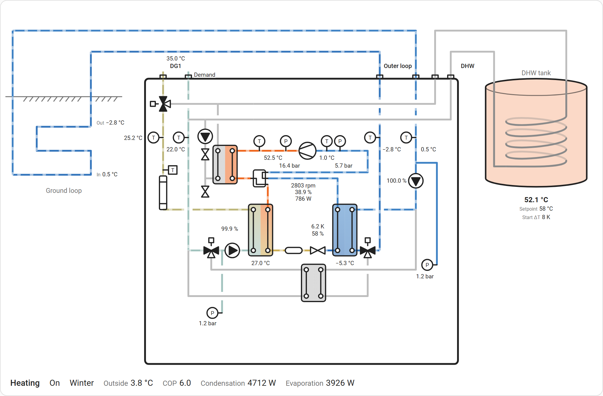

# ecoGEO heat pump card

A Lovelace card for Ecoforest ecoGEO heat pumps: the unit's internal schematic, drawn by the card as inline SVG,
with live values beside each component and the active circuits coloured by temperature. The card is read-only: it
shows the state of the unit and opens the more-info dialog of an entity, nothing else.

The card is meant to be used with the ESPHome firmware `esphome-ecoforest-ecogeo`, whose entity names are the
defaults. Every entity role can be overridden in the card configuration. See [docs/ecogeo-card.md](docs/ecogeo-card.md)
for the explanation of what the card shows and where each part comes from.



## Features

- The unit's internal schematic drawn as inline SVG after the manual's figures B1 to B4 and C, with the item number of
  every component shown only with `detail: full` (components show their name on hover), for any model, variant, outer-loop source (air, ground or hybrid) and DHW storage.
- Pipes coloured by temperature on an absolute scale (blue at -10 °C, light blue at 10 °C, pale blue at 20 °C, amber at 30 °C, orange at
  50 °C, red at 70 °C; `colors` changes the stops). Each pipe takes the probe that defines it; a pipe with no probe value is muted. The plate exchangers are
  filled on each side with a gradient from the colour of the pipe that enters it to the colour of the pipe that leaves
  it (`exchanger_fill: none` turns that off).
- The active circuits move: dashes run in the direction of the flow at a speed that follows the pump or the
  compressor, the refrigerant reverses in active cooling, and the circuits that are idle in the derived operating mode
  are muted. `prefers-reduced-motion` stops all animation.
- Live values beside their components (temperatures, pressures, pump and compressor speeds, power, superheat, the
  tank's values) and a footer with the mode, season, outside temperature, COP and capacities. The card formats the
  numbers itself with Home Assistant's locale and keeps every number joined to its unit by a no-break space.
- Read-only: tapping a value, or a component with an entity of its own, opens the entity's more-info dialog; the card calls no service and writes no entity.

## Status

Released and in use. The card validates its configuration, resolves its entities (or shows built-in sample values),
reads them, derives the operating mode and draws the schematic with coloured, flowing pipes and live values.
Planned follow-up changes: `add-card-editor`, `add-hacs-release`, `add-browser-tests` and `add-extra-circuits`.

## Installation

Copy `dist/ecogeo-card.js` to the Home Assistant `www` folder, register it as a `module` dashboard resource and add
the card to a view. The steps are in the Installation section of [docs/ecogeo-card.md](docs/ecogeo-card.md).

The card measures its own width and chooses a layout from it (the `layout` option, see Options). With `layout: auto`
(the default) it shows the full layout from 640 px wide, which is a panel view or a wide section, and the compact
layout below that, which is what a phone gets. The compact layout shows the schematic at the simplified detail
level, whatever `detail` says, without the captions inside the drawing and with only the key labels (production out and in, brine out and in, compressor
speed, the DHW temperature and the source's outlet temperature), at least 10 px high and, for production and brine, captioned In and Out, and a shorter footer (mode,
COP, outside temperature and the alarm and offline indications). Pipes and outlines never render thinner than 2 px
and 1.25 px, and the footer wraps. Once compact, the card returns to full only at 664 px (24 px of hysteresis), so a
scrollbar appearing with the layout cannot make it flip back and forth. Set `layout: full` or `layout: compact` to
force one. How the 640 px was measured, and what each tier holds, is in [docs/ecogeo-card.md](docs/ecogeo-card.md).


## Configuration

```yaml
type: custom:ecogeo-card
model: B
variant: 4
source: air
dhw: external
prefix: demo_ecogeo
features:
  passive_cooling: unused
entities:
  dhw:
    temperature: sensor.boiler_top
```

A config with only `type: custom:ecogeo-card` shows the schematic with built-in sample values (a heating day) and a
muted "Sample values" note. As soon as `prefix` or any entity is set, only real states are used: a role without an
entity shows no value, never a sample value.

An invalid config makes the card show Home Assistant's error card; the message names the option, feature or role at
fault.

### Options

| Option | Values | Default | Description |
|---|---|---|---|
| `model` | `B`, `C` | `B` | The unit model: B has an external DHW tank, C an internal one. |
| `variant` | `1` to `4` | `4` | The manual's figure B1 to B4: which cooling parts the unit has (see Features). |
| `source` | `air`, `ground`, `hybrid` | `ground` | The outer loop joined to ports 3/4. |
| `dhw` | `external`, `internal`, `none` | `external` on B, `internal` on C | The DHW storage. `internal` on model B, or `external` on model C, is an error. |
| `prefix` | lowercase letters, digits, `_` | none | Entity object id prefix; the firmware default is `ecoforest_ecogeo`. |
| `features` | group | from the variant | Feature states that override the variant (see Features). |
| `entities` | group | from the prefix | Entity id per role, nested by role path (see Roles). |
| `colors` | list | built-in scale | Temperature colour stops, see Colours. |
| `exchanger_fill` | `gradient`, `none` | `gradient` | `gradient` fills each side of the plate exchangers 7, 8, 9 and 10 with a gradient from the colour of the pipe that enters it to the colour of the pipe that leaves it (muted when the circuit is idle); `none` leaves them unfilled. |
| `layout` | `auto`, `full`, `compact` | `auto` | `auto` shows the compact layout while the card is narrower than 640 px and the full layout otherwise (and before the width is known), with 24 px of hysteresis once compact (see Layout in the docs); `full` and `compact` use that layout at any width. |
| `detail` | `simplified`, `full` | `simplified` | `simplified` leaves out the service and safety parts with no live value and shows no item numbers; `full` draws every part of the manual figure with its item number. |

### Source and DHW

`source` chooses what is drawn left of the cabinet on ports 3/4, and `dhw` the storage joined to ports 5/6 (or the
tank inside the cabinet on model C):

```yaml
# an air unit with a fan that rotates with its speed
type: custom:ecogeo-card
prefix: demo_ecogeo
source: air
dhw: external
```

```yaml
# a ground loop, and no DHW storage: no tank, no ports 5/6, no valve 26, no HTR
type: custom:ecogeo-card
prefix: demo_ecogeo
source: ground
dhw: none
```

```yaml
# air unit and ground loop on one brine loop, with the integrated tank of model C
type: custom:ecogeo-card
prefix: demo_ecogeo
model: C
source: hybrid
dhw: internal
```

| `source` | Drawn |
|---|---|
| `air` | An air unit with a four-pass coil and a fan, its brine In and Out values at its two ports on the side facing the heat pump. |
| `ground` | A ground loop: a single U-shaped loop below a ground line, with its In and Out values at the line. |
| `hybrid` | Both, in series on one brine loop (the air unit shows only its In and the ground loop only its Out). |

The top of the air unit or of the ground line is level with the top of the heat pump.

| `dhw` | Drawn |
|---|---|
| `external` | A tank with a coil right of the cabinet, joined to ports 5/6 (model B). |
| `internal` | The integrated tank 50 with coil 51 inside the cabinet (model C). |
| `none` | Nothing DHW related. |

### Features

Each key takes `true` (present and in use), `false` (not present, not drawn) or `unused` (present and drawn
muted; its own function is never derived). A key overrides the variant for that part only.

| Feature | Parts (manual items) | Variant 1 | Variant 2 | Variant 3 | Variant 4 |
|---|---|---|---|---|---|
| `active_cooling` | cycle inversion valve 14 | `false` | `false` | `true` | `true` |
| `passive_cooling` | exchanger 10, valves 27 and 28 | `false` | `true` | `false` | `true` |
| `htr` | exchanger 9, pump 17, valves 22 and 25 | `true` | `true` | `true` | `true` |
| `backup_heater` | outlet resistor 44 with thermostat 45 | `true` | `true` | `true` | `true` |

Exchanger 10 with valves 27 and 28 also serves defrost: it is active in a defrost whenever it is drawn (`true` or
`unused`).

### Roles

Every value the card reads is a role. With a `prefix`, a role defaults to `<domain>.<prefix>_<suffix>` (the
firmware entity naming); `entities` overrides single roles, nested by path: `entities: { dhw: { temperature:
sensor.boiler_top } }`. The card shows its own unit for every role, whatever the entity reports (°F and kW are
converted; a temperature difference is shown in K).

| Role | Default entity | Shown as | Manual item |
|---|---|---|---|
| `production.outlet_temperature` | `sensor.<prefix>_production_out` | °C, 1 dec. | 33 |
| `production.return_temperature` | `sensor.<prefix>_production_in` | °C, 1 dec. | 34 |
| `production.pressure` | `sensor.<prefix>_pressure_production` | bar, 1 dec. | 38 |
| `production.pump` | `sensor.<prefix>_production_pump` | %, 1 dec. | 15 |
| `brine.outlet_temperature` | `sensor.<prefix>_brine_out` | °C, 1 dec. | 31 |
| `brine.inlet_temperature` | `sensor.<prefix>_brine_in` | °C, 1 dec. | 32 |
| `brine.pressure` | `sensor.<prefix>_pressure_brine` | bar, 1 dec. | 37 |
| `brine.pump` | `sensor.<prefix>_brine_pump` | %, 1 dec. | 16 |
| `compressor.speed` | `sensor.<prefix>_compressor_rpm` | rpm, 0 dec. | 11 |
| `compressor.percentage` | `sensor.<prefix>_compressor_percentage` | %, 1 dec. | 11 |
| `compressor.power` | `sensor.<prefix>_power_consumption` | W, 0 dec. | 11 |
| `compressor.suction_temperature` | `sensor.<prefix>_compressor_suction_temperature` | °C, 1 dec. | 29 |
| `compressor.discharge_temperature` | `sensor.<prefix>_compressor_discharge_temperature` | °C, 1 dec. | 30 |
| `compressor.suction_pressure` | `sensor.<prefix>_compressor_suction_pressure` | bar, 1 dec. | 35 |
| `compressor.discharge_pressure` | `sensor.<prefix>_compressor_discharge_pressure` | bar, 1 dec. | 36 |
| `compressor.mode` | `sensor.<prefix>_compressor_operation_mode` | text | 11 |
| `refrigerant.condensation_temperature` | `sensor.<prefix>_condensation_temperature` | °C, 1 dec. | 8 |
| `refrigerant.evaporation_temperature` | `sensor.<prefix>_evaporation_temperature` | °C, 1 dec. | 7 |
| `refrigerant.superheat` | `sensor.<prefix>_superheat` | K, 1 dec. | 12 |
| `refrigerant.expansion_valve` | `sensor.<prefix>_expansion_valve_position` | %, 0 dec. | 12 |
| `heating.capacity` | `sensor.<prefix>_condensation_capacity` | W, 0 dec. | 8 |
| `cooling.capacity` | `sensor.<prefix>_evaporation_capacity` | W, 0 dec. | 7 |
| `heating.demand` | `binary_sensor.<prefix>_dg1_demand` | on/off | 1/2 |
| `heating.setpoint` | `sensor.<prefix>_heating_dg1_setpoint` | °C, 1 dec. | 1/2 |
| `dhw.temperature` | `sensor.<prefix>_dhw_temperature` | °C, 1 dec. | tank (54 on C) |
| `dhw.setpoint` | `number.<prefix>_dhw_setpoint` | °C, 0 dec. | tank |
| `dhw.start_delta` | `number.<prefix>_delta_t_start_dhw` | K, 0 dec. | tank |
| `dhw.demand` | `binary_sensor.<prefix>_dhw_demand` | on/off | 26 |
| `source.fan_speed` | `sensor.<prefix>_aerothermal_fan_speed` | %, 1 dec. | air unit |
| `source.air_unit_outlet_temperature` | `sensor.<prefix>_brine_temperature_air_unit_outlet` | °C, 1 dec. | air unit |
| `source.outside_temperature` | `sensor.<prefix>_outside_temperature` | °C, 1 dec. | air unit / footer |
| `unit.on_off` | `sensor.<prefix>_heatpump_on_off` | text | footer |
| `unit.summer` | `binary_sensor.<prefix>_summer` | on/off | footer |
| `unit.winter` | `binary_sensor.<prefix>_winter` | on/off | footer |
| `unit.alarm` | `binary_sensor.<prefix>_alarm` | on/off | footer |
| `unit.connection` | `binary_sensor.<prefix>_status` | on/off | footer |
| `unit.cop` | `sensor.<prefix>_cop` | 1 dec., no unit | footer |

A state that is `unavailable`, `unknown`, not a number or the firmware's -999.9 (an absent probe) is shown as no
value.

### Colours

`colors` is an ascending list of 2 to 8 stops, each a `temperature` in °C and a CSS `color`. Between two stops the
colour is mixed; below the first and above the last stop it is that stop's colour. A list that is too short or long,
not ascending, or with a value that is not a number or a CSS colour is a configuration error. Without the option the
card uses blue at -10 °C, light blue at 10 °C, pale blue at 20 °C, amber at 30 °C, orange at 50 °C and red at 70 °C (no green). The
plate exchangers take the colours of their pipes unless `exchanger_fill` is `none` (see the explanation below).

```yaml
colors:
  - { temperature: 0, color: '#1565c0' }
  - { temperature: 35, color: '#f9a825' }
  - { temperature: 60, color: '#c62828' }
```

The colour scale, which pipe takes which probe and the animation are explained in
[docs/ecogeo-card.md](docs/ecogeo-card.md#colours).

### Operating mode

The card derives one mode from the values, shown in the footer: Off, Defrost, DHW, Active cooling, Heating, Passive
cooling or Standby. The bridge connection (`unit.connection`) never changes the mode; it only adds an Offline
indication, and an active alarm adds an Alarm indication. The derivation and its inputs are in
[docs/ecogeo-card.md](docs/ecogeo-card.md#operating-mode).

## Development

Requires Node 22.13 or newer, 24, or 26 and newer.

```sh
npm install
npx playwright install chromium webkit  # the browsers for the browser tests and the scripts (once per machine)
npm run dev       # the emulator: the card with a mock hass, served by Vite
npm run capture   # one PNG per emulator URL in build/captures/
npm test          # both test projects: unit (Vitest, happy-dom) and browser (headless Chromium and WebKit)
npm run test:unit     # unit tests only
npm run test:browser  # browser tests only (layout at real widths, no label overlaps at the threshold)
npm run measure-layout  # re-measure the compact threshold (see docs/ecogeo-card.md)
npm run check     # typecheck, lint, format check and tests
npm run build     # bundle into build/ecogeo-card.js (git-ignored)
npm run release   # check, build, verify that the bundle registers the card, copy it to dist/ecogeo-card.js
```

### Emulator

`npm run dev` opens the emulator (`dev/index.html`): the card on a mock `hass`, with no Home Assistant, no network and
no installation data. The mock entities use the demo prefix `demo_ecogeo`.

- **Scenario:** off, standby, heating, DHW, active cooling (all heat to the outer loop), active cooling with HTR
  recovery, passive cooling, defrost, alarm while heating, bridge offline and sensors unavailable. Each is a complete
  set of states (`dev/scenarios.ts`).
- **Configuration:** model (B or C), variant (1-4), source (air, ground or hybrid), DHW storage (the model's default,
  external, internal or none), each feature (the variant's preset, `true`, `false` or `unused`), the detail level
  (simplified or full), the exchanger fill (gradient or none, the card's `exchanger_fill` option) and
  the light or dark theme. A combination the card rejects, such as model B with internal DHW, shows the config error under the card.
- **Live values:** sliders for production out and in, brine out and in, DHW temperature, discharge, suction, both
  pumps, the compressor percentage (it moves the speed too), the fan speed and the condensation capacity. Picking a
  scenario resets them. Slider values are not part of the URL state.
- **Cycle:** the cycle box steps through the capture list below, one step every 3 seconds.

All state is in the URL query string, so every combination is addressable. Parameters left out take their default.

| Parameter                                                      | Values                                                                       | Default    |
| -------------------------------------------------------------- | ---------------------------------------------------------------------------- | ---------- |
| `scenario`                                                     | `off`, `standby`, `heating`, `dhw`, `active_cooling`, `active_cooling_htr`, `passive_cooling`, `defrost`, `alarm_heating`, `offline`, `unavailable` | `heating`  |
| `model`                                                        | `B`, `C`                                                                     | `B`        |
| `variant`                                                      | `1` to `4`                                                                   | `4`        |
| `source`                                                       | `air`, `ground`, `hybrid`                                                    | `ground`   |
| `dhw`                                                          | `external`, `internal`, `none`                                               | by model   |
| `active_cooling`, `passive_cooling`, `htr`, `backup_heater`    | `true`, `false`, `unused`                                                    | by variant |
| `detail`                                                       | `simplified`, `full`                                                         | `simplified` |
| `fill`                                                         | `gradient`, `none`                                                           | `gradient` |
| `theme`                                                        | `light`, `dark`                                                              | `light`    |
| `cycle`                                                        | seconds per step; the cycle runs when it is set                              | off        |

For example `dev/index.html?scenario=passive_cooling&source=ground`.

`npm run capture` starts its own Vite server, opens every URL of the fixed list in `dev/captures.ts` in headless
Chromium (Playwright, a dev dependency for this script only) and writes one PNG per URL to `build/captures/`. The list
covers every scenario, each source, each DHW value, model C, each feature `false` and `unused`, the other variants, the dark
theme and two full-detail captures (heating and model C). The first run needs the browser: `npx playwright install chromium`.

`dist/ecogeo-card.js` is the committed, deployable bundle. `npm run format` rewrites files with Prettier.
